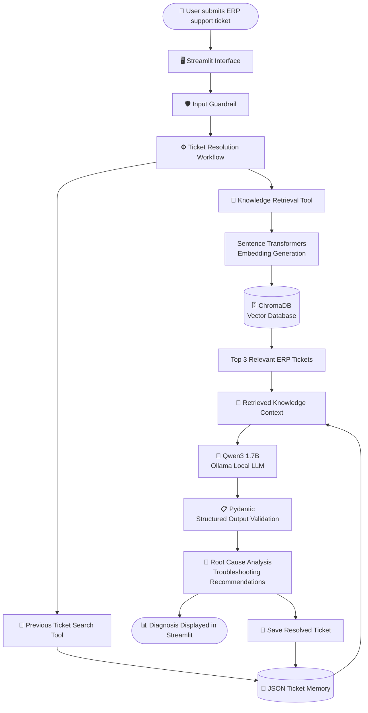

# Triagent – AI-Powered ERP Ticket Resolution System

**An end-to-end Generative AI application combining custom RAG, semantic search, tool-assisted investigation, and local LLM inference to analyse and troubleshoot Oracle ERP support tickets.**

Triagent is an AI-powered support assistant that analyses ERP issues, retrieves relevant historical tickets, identifies potential root causes, and generates structured troubleshooting recommendations.

The application combines Python-based AI development with practical ERP support knowledge to demonstrate how Large Language Models and Retrieval-Augmented Generation can be applied to enterprise support workflows.

click here to watch the demo : https://youtu.be/xktC13KtVuc

## Key Features

- **AI-Powered Ticket Analysis:** Analyses Oracle ERP support tickets and identifies potential root causes.
- **Custom RAG Pipeline:** Implements Retrieval-Augmented Generation without LangChain or LlamaIndex.
- **Semantic Search:** Uses Sentence Transformers to generate embeddings and retrieve relevant ERP issues.
- **Vector Database Integration:** Uses ChromaDB for persistent storage and similarity-based retrieval.
- **Tool-Assisted Investigation:** Uses retrieval and ticket-memory tools to support the diagnostic workflow.
- **Structured LLM Output:** Uses Pydantic to validate generated diagnoses and troubleshooting recommendations.
- **Input Guardrail:** Filters unrelated queries before starting the diagnostic workflow.
- **Persistent Ticket Memory:** Stores and retrieves previously analysed tickets using JSON.
- **Local LLM Inference:** Integrates Qwen3 1.7B through Ollama for local model execution.

## System Architecture

The architecture illustrates the end-to-end flow from user input to AI-generated diagnosis.



### Workflow

1. The user submits an ERP support ticket through the Streamlit interface.
2. An input guardrail checks whether the query is ERP-related.
3. The diagnostic workflow invokes tools to search the knowledge base and previous ticket memory.
4. Sentence Transformers generates embeddings for semantic retrieval.
5. ChromaDB retrieves the three most relevant ERP tickets.
6. Retrieved information is passed as context to the local LLM.
7. The LLM generates a diagnosis and troubleshooting recommendations.
8. Pydantic validates the generated response before it is displayed.
9. The resolved ticket can be stored in JSON memory for future reference.

## Technology Stack

| Category               | Technology                               |
| ---------------------- | ---------------------------------------- |
| Programming            | Python                                   |
| Frontend               | Streamlit                                |
| LLM                    | Qwen3 1.7B                               |
| LLM Runtime            | Ollama                                   |
| Embeddings             | Sentence Transformers – all-MiniLM-L6-v2 |
| Vector Database        | ChromaDB                                 |
| Data Validation        | Pydantic                                 |
| Data Storage           | JSON                                     |
| Retrieval Architecture | Custom RAG                               |

## Custom RAG Implementation

Implemented a custom Retrieval-Augmented Generation pipeline without using orchestration frameworks such as LangChain or LlamaIndex.

The knowledge base contains **45 ERP support ticket examples**, covering different modules, issue categories, root causes, and troubleshooting procedures.

**Retrieval workflow:**

1. Convert the incoming ticket into a vector embedding using Sentence Transformers.
2. Perform semantic similarity search against stored embeddings in ChromaDB.
3. Retrieve the top three relevant ERP support tickets.
4. Prepare the retrieved information as contextual input for the LLM.
5. Generate a diagnosis grounded in the available ticket information.

This implementation demonstrates practical understanding of embedding generation, vector storage, similarity search, context preparation, and LLM integration.

## Tool-Assisted Investigation and Ticket Memory

Triagent uses tools to support its diagnostic workflow.

- Searches the knowledge base for relevant historical issues.
- Retrieves previously analysed tickets from JSON memory.
- Uses retrieved information to support the diagnosis.
- Saves resolved tickets for potential reuse in future investigations.

The application follows a bounded tool-assisted workflow rather than operating as a fully autonomous agent.

## Structured Output with Pydantic

Pydantic validates the generated diagnosis against a predefined schema.

The structured response includes:

- ERP platform
- Module
- Issue category
- Potential root cause
- Troubleshooting steps
- Resolution guidance

This provides a consistent response format and helps ensure that the generated output follows the application's expected structure.

## Engineering Decision: Gemini to Ollama

The initial implementation used the Google Gemini API for LLM inference and embedding generation.

Free-tier API quota limitations affected development and experimentation. The implementation was subsequently migrated to local inference using Ollama and local embedding generation using Sentence Transformers.

| Initial Implementation | Current Implementation |
| ---------------------- | ---------------------- |
| Google Gemini API      | Ollama – Qwen3 1.7B    |
| Gemini Embeddings      | all-MiniLM-L6-v2       |
| Cloud-based inference  | Local inference        |

This migration provided practical experience with API integration, model selection, quota limitations, local inference, and alternative embedding approaches.

## Project Structure

```text
Triagent/
│
├── app.py
├── ask.py
├── memory.py
├── knowledge.py
├── RAG.py
│
├── knowledge_base.json
├── memory.json
│
├── erp_vector_db/
│
├── requirements.txt
├── README.md
├── DECISION_LOG.md
└── .gitignore
```

## Running the Application

**Prerequisites:** Python 3.10+, Git, and Ollama.

**1. Clone the repository**

```bash
git clone <YOUR_GITHUB_REPOSITORY_URL>
cd Triagent
```

**2. Create and activate a virtual environment**

```bash
python -m venv venv
```

For Windows:

```bash
venv\Scripts\activate
```

**3. Install dependencies**

```bash
pip install -r requirements.txt
```

**4. Download the LLM**

```bash
ollama pull qwen3:1.7b
```

Ensure that Ollama is running.

**5. Launch the application**

```bash
streamlit run app.py
```

## Current Limitations

- Does not connect to a live Oracle EBS or Oracle Fusion instance.
- Does not execute transactions or modify ERP data.
- Diagnoses are AI-generated recommendations and require verification by an ERP support professional.
- Output quality depends on the ticket description, retrieved knowledge, and LLM response.

## 🔮 Future Enhancements

- Expand the ERP knowledge base with additional support scenarios.
- Implement systematic retrieval and response evaluation.
- Support document-based knowledge ingestion.
- Explore controlled integration with Oracle ERP APIs.
- Add automated testing, logging, and performance monitoring.
- Explore more advanced agentic workflows.

## 💡 Technical Skills Demonstrated

| Skill Area              | Practical Implementation                                |
| ----------------------- | ------------------------------------------------------- |
| Python Development      | Built the application and diagnostic workflow           |
| Generative AI           | Integrated a local Large Language Model                 |
| RAG                     | Developed a custom retrieval pipeline                   |
| Embeddings              | Implemented semantic vector generation                  |
| Vector Databases        | Integrated ChromaDB for similarity search               |
| LLM Integration         | Integrated Qwen3 using Ollama                           |
| Tool Usage              | Implemented knowledge retrieval and ticket-memory tools |
| Data Validation         | Used Pydantic for structured LLM responses              |
| Application Development | Built an interactive Streamlit interface                |
| Data Persistence        | Implemented JSON-based ticket memory                    |

## 📊 Model Evaluation Results

The application was manually evaluated using **30 representative Oracle ERP support scenarios**.

Testing focused on:

- ERP module and issue identification.
- Relevance of retrieved knowledge.
- Root cause identification.
- Quality and sequence of troubleshooting recommendations.
- Structured output validation.

The evaluation was qualitative and intended to assess application behaviour across representative support scenarios. It is not a formal production accuracy benchmark.

| Evaluation Category | Number of Scenarios |
|---|---:|
| Correct | 16 |
| Partially Correct | 10 |
| Incorrect | 4 |
| **Total Evaluated** | **30** |

The evaluation demonstrated that Triagent could generate relevant diagnoses across multiple Oracle ERP modules. Testing also highlighted opportunities to improve root-cause identification, retrieval relevance, and the completeness of troubleshooting recommendations.

## Project Takeaway

Triagent demonstrates the practical implementation of Generative AI concepts in an enterprise support use case. It combines custom RAG, semantic retrieval, local LLM inference, tool-assisted investigation, structured output validation, and application development into a single working application.

**Built with Python | Generative AI | RAG | Sentence Transformers | ChromaDB | Ollama | Pydantic | Streamlit**
