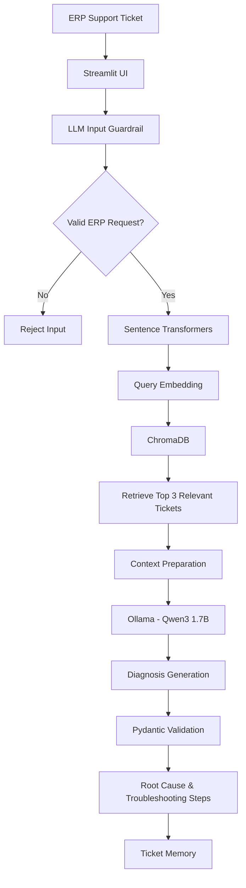

# Triagent | AI-Powered ERP Ticket Resolution System

**An LLM-powered ERP support assistant built using custom RAG, semantic search, and local inference.**

Triagent analyses Oracle ERP support tickets, retrieves relevant historical issues, identifies potential root causes, and generates structured troubleshooting recommendations.

The project demonstrates the practical application of Generative AI to enterprise support workflows through a custom RAG pipeline built without LangChain or LlamaIndex.

## 🚀 Key Features

- **Intelligent Ticket Analysis:** Analyses Oracle ERP issues across AP, AR, Purchasing, Inventory, and Order Management.
- **Custom RAG Pipeline:** Retrieves relevant historical tickets to provide contextual information for LLM-based diagnosis.
- **Semantic Search:** Uses Sentence Transformers and ChromaDB to retrieve similar support issues.
- **Root Cause Analysis:** Generates potential explanations for reported issues.
- **Structured Troubleshooting:** Produces step-by-step recommendations using Pydantic-validated output.
- **Input Guardrail:** Uses an LLM-based validation mechanism to filter unrelated requests.
- **Ticket History:** Saves and enables searching of previously analysed tickets through Streamlit.

## 🧠 Architecture



**How it works:** The application validates the submitted ticket, converts it into an embedding, retrieves relevant historical tickets from ChromaDB, and passes the retrieved context to the local LLM. The generated diagnosis is validated and displayed through the Streamlit interface.

## 🛠️ Tech Stack

| Technology        | Implementation                           |
| ----------------- | ---------------------------------------- |
| Language          | Python                                   |
| UI                | Streamlit                                |
| LLM               | Ollama – Qwen3 1.7B                      |
| Embeddings        | Sentence Transformers – all-MiniLM-L6-v2 |
| Vector Database   | ChromaDB                                 |
| Output Validation | Pydantic                                 |
| Data Storage      | JSON                                     |

## 🔄 Engineering Decision: Gemini to Ollama

The initial implementation used the **Google Gemini API** for LLM inference and embedding generation.

During development, free-tier API quota limitations affected experimentation. The application was subsequently migrated to a local setup:

| Initial Approach    | Current Approach    |
| ------------------- | ------------------- |
| Gemini API          | Ollama – Qwen3 1.7B |
| Gemini Embeddings   | all-MiniLM-L6-v2    |
| Cloud API inference | Local inference     |

This migration provided hands-on experience with different model integrations, API limitations, local inference, and embedding alternatives.

## 📊 Knowledge Base & Testing

- **45 ERP support ticket examples** in the knowledge base.
- Semantic retrieval using local vector embeddings.
- Tested the application with approximately **25 tickets** during development.

## 📂 Project Structure

```text
Triagent/
├── app.py                 # Streamlit interface
├── ask.py                 # Guardrail, RAG and LLM inference
├── memory.py              # Ticket memory and search
├── knowledge_base.json    # ERP support knowledge base
├── memory.json            # Ticket history
├── erp_vector_db/         # ChromaDB persistence
├── requirements.txt
├── README.md
├── DECISION_LOG.md
└── .gitignore
```

## ⚙️ Run Locally

**Prerequisites:** Python 3.10+, Git, and Ollama.

**1. Clone the repository**

```bash
git clone <YOUR_GITHUB_REPOSITORY_URL>
cd Triagent
```

**2. Create and activate a virtual environment**

```bash
python -m venv venv
venv\Scripts\activate
```

**3. Install dependencies**

```bash
pip install -r requirements.txt
```

**4. Download the Ollama model**

```bash
ollama pull qwen3:1.7b
```

**5. Launch the application**

```bash
streamlit run app.py
```

## 🔮 Future Enhancements

- Quantitative RAG retrieval and response evaluation.
- Improved evidence-grounded diagnosis.
- REST API integration with ERP systems.
- Expanded ERP knowledge base.
- Automated testing and logging.
- Cloud deployment and agentic AI capabilities.

## 🎯 What This Project Demonstrates

- Building a custom RAG pipeline without an orchestration framework.
- Working with embeddings and vector databases.
- Integrating and migrating between LLM providers.
- Implementing structured LLM outputs with Pydantic.
- Developing an end-to-end Generative AI application.

---

**Built with Python | RAG | Ollama | ChromaDB | Streamlit**

GitHub: [Repository Link]
